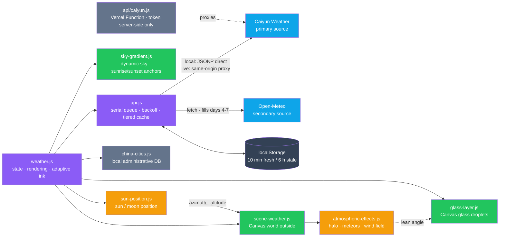

<p align="center"><a href="./README.md">简体中文</a> | <b>English</b></p>

<div align="center">

<picture>
  <source media="(prefers-color-scheme: dark)" srcset="./docs/images/logo-white.png" />
  
</picture>

# AeroWeather

**A Caiyun-powered weather dashboard: zero build, zero npm dependencies, 11 native ES Modules painting "outside the window" frame by frame**

It doesn't pour numbers into cards — it draws the world outside the window. The sun hangs at its real altitude, the 22° halo shows up where it belongs, rain streaks lean by the wind speed and direction Caiyun actually reported, and the droplets on the glass can be wiped aside with a fingertip.

[**weather.abobb.com**](https://weather.abobb.com) &nbsp;·&nbsp; [Tour](#a-tour-of-the-interface) &nbsp;·&nbsp; [Three-Layer Canvas](#three-layer-canvas-rendering) &nbsp;·&nbsp; [Quick Start](#quick-start) &nbsp;·&nbsp; [Issues](https://github.com/abobb414/AeroWeather/issues)

[](https://weather.abobb.com)
[](#quick-start)
[](#technical-architecture)
[](#project-structure)
[](#city-search-local-first--online-fallback)
[](#changelog)

</div>


---

## A Tour of the Interface

> Every screenshot is taken from the live production site. The dashboard clock is pinned with the built-in debug hook `window.__skyTime(h)`; the weather, temperature and air quality are **real data from the morning of 2026-10-09** — Beijing was foggy that morning with an AQI of 130, which washed the whole frame out, so the shots use Qingdao at the same moment (AQI 36 / 4% cloud cover) to show the sky layer properly.
> The eight scenes and the four feature shots come from the [Convection Playground](https://weather.abobb.com/storm.html), which **shares the exact same render engine** (`sky-gradient` / `scene-weather` / `glass-layer`) as the main site. Collapse the panel and you get a pure weather frame — the most direct way to see what any given weather looks like.

### Main Dashboard

<table>
  <tr>
    <td align="center" width="50%">
      <br>
      <sub><b>Daytime</b> · temperature, six live readings, 24-hour curve and a 7-day forecast with proportional range bars</sub>
    </td>
    <td align="center" width="50%">
      <br>
      <sub><b>Night</b> · sky luminance drives card opacity, ink colour and droplet lighting all at once</sub>
    </td>
  </tr>
</table>

<div align="center">

**Mobile** — the same codebase adapting at a 390px viewport.


</div>

### Eight Weather Scenes

The sky is modulated per weather condition (dimmed / desaturated / tinted), while precipitation, lightning and glass droplets are each drawn independently. All eight shots are pinned to **13:00 the same day** so the sky tints can be compared side by side — the clear one still shows a faint ring around the sun (cloudy only gets 0.55 of the strength):

<table>
  <tr>
    <td align="center" width="50%">
      <br>
      <sub><b>Clear</b> · brightest sky, the sun wears a 22° halo</sub>
    </td>
    <td align="center" width="50%">
      <br>
      <sub><b>Cloudy</b> · cloud cover pushes the sky down and desaturates it; halo drops to 0.55</sub>
    </td>
  </tr>
  <tr>
    <td align="center" width="50%">
      <br>
      <sub><b>Overcast</b> · stars gone, sky pushed to its heaviest</sub>
    </td>
    <td align="center" width="50%">
      <br>
      <sub><b>Fog</b> · haze washes the sky out, the horizon turns flat grey</sub>
    </td>
  </tr>
  <tr>
    <td align="center" width="50%">
      <br>
      <sub><b>Drizzle</b> · sparse streaks, droplets just starting on the glass</sub>
    </td>
    <td align="center" width="50%">
      <br>
      <sub><b>Rain</b> · dense slanted streaks, droplets at full activity</sub>
    </td>
  </tr>
  <tr>
    <td align="center" width="50%">
      <br>
      <sub><b>Thunderstorm</b> · densest rain and darkest sky, forked lightning (frozen frame)</sub>
    </td>
    <td align="center" width="50%">
      <br>
      <sub><b>Snow</b> · flakes fall slowly, density on par with rain</sub>
    </td>
  </tr>
</table>

### Convection Playground

A standalone page, `storm.html`: eight weather scenes × any hour, freely combined. The panel on the right reports the scene, particle counts and live fps, and offers follow-real-time, pause, **freeze lightning** (pause the loop, render one frame by hand, leave the forked branches on screen) and a droplet-layer toggle. Its readout streams `sun` (azimuth / altitude / halo strength) and `wind` (speed / direction / lean) live. In the shot below the wind is 45 km/h from 270°, and the readout reports `lean: -16.3°`.


---

## Table of Contents

- [A Tour of the Interface](#a-tour-of-the-interface)
- [Technical Architecture](#technical-architecture)
  - [Three-Layer Canvas Rendering](#three-layer-canvas-rendering)
  - [Data Sources and Ground Rules](#data-sources-and-ground-rules)
  - [City Search: Local-First + Online Fallback](#city-search-local-first--online-fallback)
- [Core Features](#core-features)
  - [22° Halo: The Sky Finally Has a Sun](#22-halo-the-sky-finally-has-a-sun)
  - [Real Wind Field: Rain Direction Comes From Caiyun](#real-wind-field-rain-direction-comes-from-caiyun)
  - [Clear-Night Meteors](#clear-night-meteors)
  - [Finger-Wipe Fog](#finger-wipe-fog)
- [Quick Start](#quick-start)
- [Deployment](#deployment)
- [Project Structure](#project-structure)
- [Local Checks](#local-checks)
- [Engineering Notes: The Pits We Fell Into](#engineering-notes-the-pits-we-fell-into)
- [Limitations](#limitations)
- [Changelog](#changelog)

---

## Technical Architecture



The whole frontend is built from **native ES Modules** — no framework, no bundler. The repository root *is* the deploy artifact.

### Three-Layer Canvas Rendering

The visual system is three layers, back to front, each independent and unaware of the others:

| Layer | File | Contents |
|---|---|---|
| Sky gradient | `sky-gradient.js` | Hour-interpolated full-screen gradient, modulated per weather (dim / desaturate / tint); the dawn and dusk segment anchors are bound to the location's **real sunrise and sunset** |
| World outside | `scene-weather.js` | Horizon warm band, 22° halo (ice-crystal spectrum + lens ghosts), stars, rain and snow particles (leaned by the real wind field), clear-night meteors, lightning (per-frame state machine, three-pass forked strokes) |
| Glass droplets | `glass-layer.js` | Close-up droplets: wetting ring, lens body, highlight, shadow and sliding trails; six layers baked into 24 sprites; wipable by finger in the rain |

Sky luminance drives both the **ink switch** (`<html data-ink="light\|dark">`) and **droplet lighting** (street-lamp colour compensation at night), so the three layers and the typography always agree. The sun's and moon's real positions are computed per frame by `sun-position.js` and fed to the halo, the meteors and the wind field — that is the skeleton of 2.0.0.

### Data Sources and Ground Rules

| Tier | Source | Responsibility |
|---|---|---|
| Primary | **Caiyun Weather** | Live conditions, 24-hour hourly, air quality (PM2.5 / PM10 / national AQI), one-line forecast, 3-day outlook and sunrise/sunset |
| Secondary | **Open-Meteo** | Fills days 4–7 that Caiyun's trial tier won't give; the UV index **always** comes from this source |

| Rule | Value | Where |
|---|---|---|
| Fresh cache | 10 minutes | A cache hit sends zero requests |
| Stale fallback | 6 hours | Old data is used when rate-limited, and the footer says so |
| Total data budget | 6 seconds | On timeout the whole chain switches to Open-Meteo |
| Sky recompute | 60 seconds | `setInterval(updateSkyGradient, 60000)` |

Caiyun's API sends no CORS headers: **local development** talks to it directly via its official **JSONP form**, while **production** goes through the same-origin serverless proxy `api/caiyun.js`. A pure static site cannot hide a secret — the token lives only in the deployment platform's environment variable (`CAIYUN_TOKEN`), never in a byte of the static files. The proxy whitelists request paths so it can't become an open proxy.

> This one was paid for: an early version shipped the token inside `js/config.local.js`, and it sat on the public internet for three days. The rule now is that a static site has no "hide the secret" option — anything inside the deploy directory can be downloaded with `curl`, so the only fix is keeping it **out of there entirely**.

A serial queue with exponential backoff handles 429s. The footer always names the source actually used; if both chains fail, the page falls back to local sample data and **says so**, rather than silently pretending.

### City Search: Local-First + Online Fallback

- **Local administrative database** (`assets/china-cities.json` — 34 provinces / 363 cities / 2855 districts, 3252 entries with centre coordinates, 174 KB / 53 KB gzipped) is lazily loaded on first search and pre-warmed while idle. It strips generic suffixes like 市 / 区 / 新区 and scores matches, answering offline in milliseconds.
- The online fallback uses Open-Meteo geocoding, querying **multiple traditional/simplified glyph variants in parallel** and sorting by population — Chinese aliases in GeoNames mix the two scripts, so 东京 must be looked up as 東京.

---

## Core Features

| | Feature | Description |
|---|---|---|
| 🌤 | **Live conditions** | Temperature, feels-like, high/low, humidity, wind speed and direction (Beaufort), precipitation, surface pressure |
| 🌫 | **Air quality** | PM2.5 / PM10 with national grading, on a six-stop gradient band whose cursor takes its colour from its position on that very gradient |
| 🕐 | **Hourly and multi-day forecast** | 24-hour temperature curve (icons switch with day/night); a 7-day forecast with proportional range bars |
| ⭕ | **22° halo** | Appears by the sun's real altitude and azimuth, with an ice-crystal spectrum (red inside, blue outside) and lens ghosts — see [below](#22-halo-the-sky-finally-has-a-sun) |
| 🍃 | **Real wind field** | Caiyun's wind speed and direction lean the rain streaks (0° → 20°) and deflect the glass trails — see [below](#real-wind-field-rain-direction-comes-from-caiyun) |
| 🌠 | **Clear-night meteors** | One every 45–90 seconds when it's dark and clear or partly cloudy; a chance encounter, never a swarm — see [below](#clear-night-meteors) |
| 💧 | **Finger-wipe fog** | Drag on the glass in the rain to wipe a clear swath; it slowly fogs back once you stop — see [below](#finger-wipe-fog) |
| ⚡ | **Lightning rim flash** | For the few tens of milliseconds of a strike, the top edge of every glass surface is lit by the same cold-white light |
| 🎨 | **Three-layer Canvas** | Sky gradient → world outside → close-up glass droplets — see [above](#three-layer-canvas-rendering) |
| 🌅 | **Real sunrise and sunset** | The sky's dawn and dusk anchors are bound to the located place's actual sunrise and sunset |
| 🏙 | **Nationwide city search** | Offline database of 34 provinces / 363 cities / 2855 districts, tolerant of glyph variants |
| 🧪 | **Convection Playground** | Standalone `storm.html`: 8 weather scenes × any hour, with lightning freezing, particle counts and live fps |
| 🌙 | **Adaptive ink** | Text and icons switch between light and dark ink with sky luminance, readable at any hour |
| 📱 | **Responsive** | Phone / tablet / desktop layouts from one codebase |

### 22° Halo: The Sky Finally Has a Sun

A sky with no sun position can only draw a decorative ring. 2.0.0 adds `js/sun-position.js` (a simplified SPA algorithm, ±0.5° on azimuth and altitude) which hands the sun's real position to the renderer every frame, so the ring lands where the sun **actually is**.

Whether it appears is decided by **solar altitude**, not by the clock:

| Solar altitude | Halo strength |
|---|---|
| < 8° | not drawn |
| 8° → 18° | linear fade-in |
| ≥ 18° | full strength |

> Hard-coding "halo from 9am to 3pm" is wrong in both season and longitude. At Beijing's winter solstice the sun is only 12° at 09:00; Kashgar runs on Beijing time, so its solar time lags by over two hours and the sun has barely cleared the horizon at 09:00. Solar altitude is the only criterion that holds at every latitude and every season.

Weather only contributes on **clear (factor 1.0) / partly cloudy (0.55)** days; in any other weather there is no sun to see. The ring is an ice-crystal refraction spectrum (red inside, blue outside; sharp inner edge, soft outer one) with a radius of one fifth of the screen diagonal (clamped to 150–420 px), plus four very faint lens ghosts laid along the "sun → screen centre" line.

<div align="center">


<sub>16:24 near dusk, with the sun down around 18° the full ring is visible. The portrait crop is deliberate: the sun's screen Y is always near the top (`y = h·lerp(0.24, 0.07, …)`), so a landscape frame always cuts off most of the ring.</sub>

</div>

The sun, its star spikes and the ring are **baked into a single sprite**, so each frame costs one `drawImage`. The first frame lands instantly (opening a page shouldn't show it slowly lighting up); switching weather or dragging the hour cross-fades over about 1.5 seconds.

### Real Wind Field: Rain Direction Comes From Caiyun

Caiyun's `wind_speed_10m` / `wind_direction_10m` finally reach the picture:

| Wind speed | Rain lean angle |
|---|---|
| < 10 km/h | vertical |
| 10 → 20 | 0° → 8° |
| 20 → 40 | 8° → 15° |
| 40 → 60 | 15° → 20° |

The direction is projected onto the horizontal axis of a viewer facing the equator (in the northern hemisphere an easterly wind pushes rain west, i.e. screen-right; the southern hemisphere mirrors it).

<table>
  <tr>
    <td align="center" width="50%">
      <br>
      <sub><b>6 km/h</b> · lean 0.0°, streaks vertical</sub>
    </td>
    <td align="center" width="50%">
      <br>
      <sub><b>52 km/h easterly</b> · lean 18.0°, the whole field tilts right</sub>
    </td>
  </tr>
</table>

> Both frames are the same weather scene and the same wind direction — only the speed differs. It is the one controlled comparison in this renderer: change exactly one variable, leave everything else alone. A due-south or due-north wind has zero horizontal component, but a real field of view is never pointed exactly along the wind, so a **40% horizontal floor** is kept — otherwise "there is obviously a gale but the rain is straight" looks broken.

`lean` eases into place over about a second (`1 - e^(-2.2·dt)`) rather than snapping. That work also fixed something that had been wrong all along: **a rain streak's direction of travel and its drawn angle used to be two different things** — the line was slanted while the particle still fell straight down, which reads as a headwind. They now share one lean angle (`vx = vy·tan(lean)`). Each streak additionally carries a `0.82–1.12` wind-response factor, so heavier drops move less and the field reads as one weather rather than a row of parallel lines.

### Clear-Night Meteors

They can only spawn when the solar altitude is below −6° (night) and the weather is clear or partly cloudy, at random 45–90 second intervals, living 0.4–0.6 s at 900–1400 px/s with a 110–180 px tail. Brightness follows a fast-in, slow-out curve (lit over the first 15%, then dissolving all the way out). A chance encounter, never a swarm.

<div align="center">


<sub>A 2× crop located by the brightest pixel cluster — across the full frame it is only a thin line, so this view is enlarged to make it legible.</sub>

</div>

### Finger-Wipe Fog

In the rain you can drag on the glass to wipe a clear swath (sampling the brush every ≤ 8 px along the path); it slowly fogs back once you stop. Sliding droplets are also nudged by the wind field (`drift += windAngle × 0.15`), which gives their trails a faint natural curve.

<div align="center">


<sub>Three overlapping arcs — the path a fingertip actually leaves after a couple of passes.</sub>

</div>

> The listener is attached to `window`, not to the canvas: the glass canvas is `pointer-events: none` (it must not block the content beneath it), so it never receives pointer events itself.

---

## Quick Start

This project is a **zero-build static site** — no `npm install`, no bundler, any static server will do.

```bash
# 1) Configure the Caiyun token (optional · only affects local development; production uses env vars, see Deployment)
cp js/config.example.js js/config.local.js
# Then edit js/config.local.js and replace YOUR_CAIYUN_TOKEN with your own token
# Application portal: https://dashboard.caiyunapp.com/

# 2) Start a static server
python3 -m http.server 8000
```

Open [http://localhost:8000](http://localhost:8000) and the root path renders the weather page directly (a `vercel.json` rewrite handles the root; the same applies when you serve locally through the Vercel CLI).

> **Two things to note**
> 1. **Serve it over http (or https) — do not open the files with `file://`.** The project uses ES Modules, which CORS blocks under the `file://` protocol.
> 2. `js/config.local.js` is listed in both `.gitignore` and `.vercelignore`, so it is **neither committed nor deployed**. The repository only ships the template `js/config.example.js`; without a token the page degrades gracefully to the key-free Open-Meteo source with no loss of functionality.

There is also a standalone playground page, [storm.html](https://weather.abobb.com/storm.html): eight weather scenes × any hour, with lightning freezing and a droplet-layer toggle, for tuning convective visuals in isolation. It accepts URL parameters (`?scene=rain&hour=13&wind=52&dir=90&panel=0`), which is how every screenshot and regression in this document is reproduced.

---

## Deployment

The output is pure static, so Vercel / Cloudflare Pages / GitHub Pages all host it directly. No backend is required beyond the Caiyun data source; to use Caiyun in production you need one small forwarding function:

| Platform | Configuration |
|---|---|
| **Vercel** | Framework Preset `Other`; leave Build Command and Output Directory empty |
| **Cloudflare Pages** | Leave the build command empty, output directory `/` |
| **GitHub Pages** | Settings → Pages → Source: branch root |

> **How do I wire up Caiyun in production?**
>
> `js/config.local.js` is not in the repository, so a platform building from GitHub never has that file — which is **exactly the point**. In a static site every file is publicly downloadable, and putting the token in one publishes it.
>
> Production therefore uses the same-origin proxy `api/caiyun.js`: Vercel compiles anything under `api/` at the root into a Serverless Function, and the token lives in an environment variable, not in a byte of static output.
>
> ```bash
> vercel env add CAIYUN_TOKEN production   # paste the token, then redeploy
> ```
>
> The frontend only ever talks to `/api/caiyun` on its own origin, so the public internet never sees the token, and rotating it later touches an env var rather than code. Other platforms (Cloudflare Workers / Pages Functions) can port those 80 lines — but **do not** fall back to writing the token into a static file.
>
> It also runs without one: the page degrades to the key-free Open-Meteo source and the footer states which source was actually used.

> 🔴 **This project has one extra mandatory deployment step**
>
> After `vercel --prod` finishes, the custom domain does **not** follow the new deployment — `weather.abobb.com` keeps serving the previous build, which looks like "the deploy succeeded but the site is still old". Every release needs the alias pointed over by hand and then verified:
>
> ```bash
> vercel --prod --yes
> vercel alias set <this deployment URL> weather.abobb.com
> vercel alias ls          # verify the source
> ```
>
> Also note: the direct `*.vercel.app` deployment URLs all 302 to `/sso-api` (deployment protection), so they **cannot** be used to verify content — check through the real domain instead.

---

## Project Structure

```
├── weather.html            # main page
├── storm.html              # convection playground (standalone, no data source)
├── vercel.json             # root rewrite → weather.html
├── api/
│   └── caiyun.js           # Caiyun proxy: token in platform env vars, absent from static files
├── css/
│   ├── weather.css         # frosted-glass component system · ink variables
│   └── sky-gradient.css    # sky layer styles
├── js/
│   ├── weather.js          # state · rendering · adaptive ink
│   ├── api.js              # source tiers · Caiyun dual channel · caching
│   ├── sky-gradient.js     # sky gradient · sunrise/sunset anchors
│   ├── sun-position.js     # sun / moon azimuth and altitude (simplified SPA)
│   ├── atmospheric-effects.js  # halo · meteors · wind field · lightning rim flash
│   ├── scene-weather.js    # Canvas world outside (rain/snow/lightning/haze/halo/meteors)
│   ├── glass-layer.js      # Canvas glass droplets (six sprite layers · finger wipe)
│   ├── weather-codes.js    # 31 WMO codes → icons and Chinese labels
│   ├── china-cities.js     # local city search and matching
│   ├── zh-variant.js       # traditional/simplified glyph variant table
│   ├── storm.js            # playground panel logic
│   └── config.example.js   # Caiyun token template (config.local.js is never committed)
├── assets/
│   ├── china-cities.json   # 3252 administrative entries (with centres, 174 KB / 53 KB gzipped)
│   ├── logo-weather.png    # wordmark (ink mask)
│   └── favicon.*           # site icons: svg (preferred) + seven .ico frames + 16/32/180 png
└── docs/screenshots/       # README assets: 3 dashboard + 8 weather + playground + 4 feature shots
```

Scale: 11 frontend modules, **5440 lines** (excluding the config template), plus 1578 lines of CSS and HTML.

---

## Local Checks

The repository currently ships **no automated test suite** (the `test/` directory is not in version control), so day-to-day changes go through three manual checks:

```bash
# 1) Syntax check everything (11 modules + the proxy function)
for f in js/*.js api/*.js; do node --check "$f" || echo "FAIL $f"; done

# 2) Start a local static server (it must stay resident in the background,
#    otherwise the child process is reaped when the shell call returns)
python3 -m http.server 8791 --bind 127.0.0.1 &

# 3) Live health check: did the proxy pick up the token?
curl -s 'https://weather.abobb.com/api/caiyun?health'   # → {"ok":true,"hasToken":true}
```

The page exposes three **debug / automation hooks** that regression scripts use to pin the picture to a deterministic state:

| Hook | Purpose |
|---|---|
| `window.__skyTime(h)` | Render one frame at a given hour; `null` returns to real time (same name and meaning on both pages) |
| `window.__sunAnchors(rise, set)` | Inject test sunrise/sunset anchors to exercise the sky's segment boundaries |
| `window.__sceneWeather` / `__glassLayer` | Expose both canvas engines for asserting layer order, particle counts and wind `lean` |

The playground additionally accepts `?scene=&hour=&wind=&dir=&halo&panel=0` — every weather screenshot in this document was reproduced that way.

---

## Engineering Notes: The Pits We Fell Into

- **Halo by solar altitude, not by the clock** — see [above](#22-halo-the-sky-finally-has-a-sun). This is the clearest case in the project of intuition writing the wrong thing.
- **The sun's position and the sky gradient must share one clock** — the sky interpolates by hour, so the sun must be computed from the same hour (`setClock()`). Otherwise dragging the playground to noon leaves the sun at its real-time position, and the halo and the sky tint disagree.
- **A rain streak's direction of travel *is* its drawn angle** — both share one lean (`vx = vy·tan(lean)`). Compute them separately and you get "slanted but falling straight", which reads as a headwind.
- **The lightning highlight never touches `border-color`** — the top-edge highlight on glass surfaces is a `::after` pseudo-element with an `inset` shadow. The existing `.22s` border transition turns a flash into a slow brightening.
- **`--lightning-rim` is written only when the value changes** — calling `setProperty` every frame forces a full-page style recalculation every frame.
- **`html` / `body` must not have an opaque background** — the sky layer and the world layer both use negative `z-index`, and negative layers are painted *below the root background*. The moment `body` gets a colour, those two layers are wiped out and only the glass droplets remain (measured: a plain black field with white dots).
- **The sky gradient must not have a `transition`** — gradients aren't interpolable, so it hard-cuts anyway, and the transition instead makes the two viewport-edge sampling bands lag behind (`sky-edge-tint`, built to feed Safari 26's toolbar tint sampler; that behaviour is filed as WebKit bug 325446).
- **`.md` and `.env*` must be listed in `.vercelignore`** — `.gitignore` has **no effect** on Vercel. This project's README / CHANGELOG and the `.env.local` that `vercel link` generates (containing `VERCEL_OIDC_TOKEN`) are kept out of the deployment by that single line; otherwise they appear at the site root. After every release, spot-check that `/README.md`, `/js/config.local.js` and `/.env.local` all return 404.
- **Screenshots cannot be taken with plain `fullPage`** — the sky layer is `position: fixed; inset: 0` and covers only the viewport, so `fullPage` stitches a white field below the viewport height (at night, white text on white). The fix is to converge the viewport height to the full page height first, then shoot.

---

## Limitations

- **Caiyun's trial tier gives only 3 daily steps and fairly tight rate limits** — days 4–7 are filled by Open-Meteo and the footer says so; the UV index always comes from Open-Meteo.
- **The halo and meteors are simplified models** — the 22° ring's radius is a proportion of the screen rather than a true angular projection (a real 22° halo is a fixed angular radius in the sky), and meteors spawn on a random 45–90 second cadence rather than a real meteor-shower model. Both aim for "looks right", not astronomical accuracy.
- **Coverage stops at the district level** — the database reaches the 2855 districts; finer place names rely on online geocoding.
- **The cost of zero build** — no bundling and no tree-shaking, modules load on demand, so the first load issues slightly more requests than a bundled site. What you get back is edit-refresh-and-see debugging and a "repository root is the artifact" deployment model.
- **The only external static dependency is Google Fonts** — if it fails to load, the page falls back to system fonts with no loss of functionality.

---

## Changelog

See [CHANGELOG.md](CHANGELOG.md). Current version **v2.0.2** (2026-10-09).

---

## Copyright

**Designed & Coded by AlistairBo · © 2026**

All code, copy, interface design and screenshots in this project were designed and built by
**AlistairBo**, who holds the copyright.

The interface icons come from [Icons8](https://icons8.com), credited here as required by their free
licence; weather data is provided by [Caiyun](https://caiyunapp.com) and
[Open-Meteo](https://open-meteo.com), each retaining its own copyright.
The brand icon in the top-left corner is derived from `pulsar-line / partly-cloudy-day`
(official 1600px source) by trimming and proportional downscaling; its white variant was produced
by inverting the black pixels of that source.
