<p align="center"><b>简体中文</b> | <a href="./README.en.md">English</a></p>

<div align="center">

<picture>
  <source media="(prefers-color-scheme: dark)" srcset="./docs/images/logo-white.png" />
  
</picture>

# AeroWeather

**彩云天气驱动的天气看板：零构建、零 npm 依赖，12 个原生 ES Module 逐帧绘出「此刻窗外」**

不是把数字塞进卡片，而是把窗外的世界画出来 ——
太阳按真实高度角悬挂，22° 日晕出现在它该在的地方，雨丝按彩云给的风速风向倾斜，
玻璃上的水珠能被指尖擦出一道水膜。

[**weather.abobb.com**](https://weather.abobb.com) &nbsp;·&nbsp; [界面一览](#界面一览) &nbsp;·&nbsp; [三层 Canvas](#三层-canvas-渲染) &nbsp;·&nbsp; [快速开始](#快速开始) &nbsp;·&nbsp; [Issues](https://github.com/abobb414/AeroWeather/issues)

[](https://weather.abobb.com)
[](#快速开始)
[](#技术架构)
[](#项目结构)
[](#城市检索本地优先--在线兜底)
[](#更新日志)

</div>

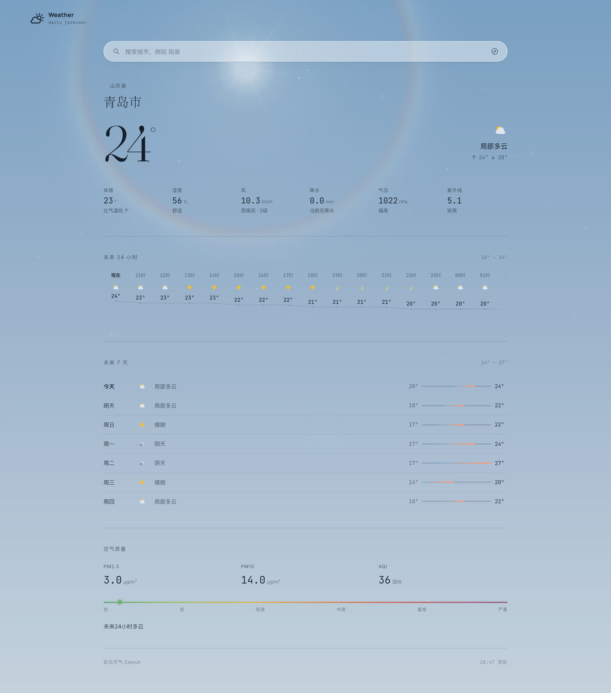

---

## 界面一览

> 截图全部取自主站线上运行版本。主看板的时刻由内置调试接口 `window.__skyTime(h)` 固定，
> 天气、温度与空气质量是 **2026-10-09 上午的真实数据** —— 当时北京有雾、AQI 130，
> 画面被洗得很淡，于是取了同时刻晴朗的青岛（AQI 36 / 云量 4%）来看清天空层。
> 「八种天气」与四张特性图取自[强对流实验台](https://weather.abobb.com/storm.html)：
> 它与主站**共用同一套渲染引擎**（`sky-gradient` / `scene-weather` / `glass-layer`），
> 收起面板后就是纯天气画面，是「各种天气长什么样」最直接的来源。

### 主看板

<table>
  <tr>
    <td align="center" width="50%">
      <br>
      <sub><b>白天</b> · 温度、六项实况、24 小时逐时曲线与 7 天预报（含比例温差条）</sub>
    </td>
    <td align="center" width="50%">
      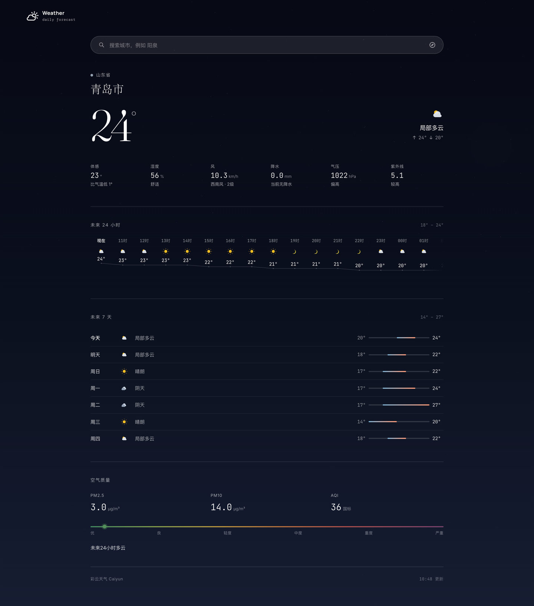<br>
      <sub><b>夜间</b> · 天空亮度同时驱动卡片透明度、文字墨色与水珠采光</sub>
    </td>
  </tr>
</table>

<div align="center">

**移动端** —— 同一套代码在 390px 视口下自适应。

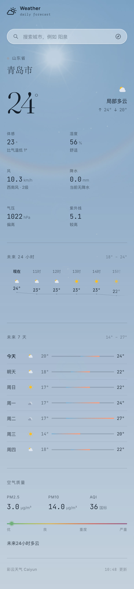

</div>

### 八种天气

天空按天气调制（压暗 / 去饱和 / 染色），降水、闪电与玻璃水珠各自独立绘制。
下面八张**全部取同一时刻 13:00**，便于横向比较天色差异 ——
晴天那张还能看到太阳周围淡淡的一圈晕（多云强度只有晴天的 0.55，所以更弱）：

<table>
  <tr>
    <td align="center" width="50%">
      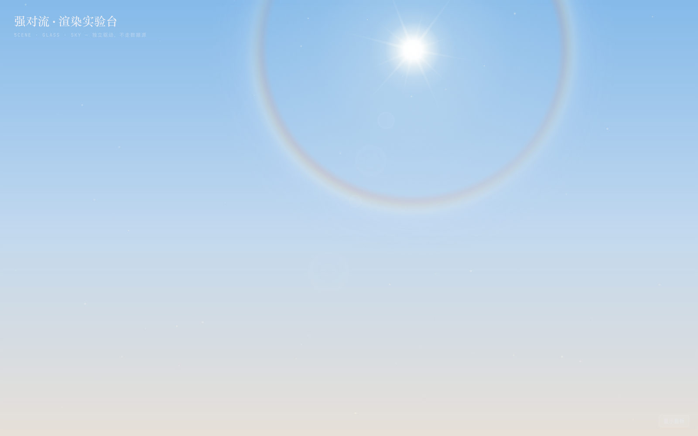<br>
      <sub><b>晴</b> · 天色最亮，太阳戴着 22° 晕</sub>
    </td>
    <td align="center" width="50%">
      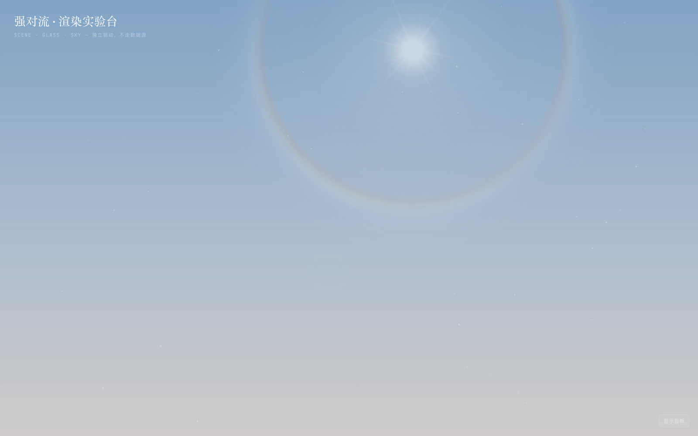<br>
      <sub><b>多云</b> · 云量抬升，天色压暗去饱和，晕只剩 0.55</sub>
    </td>
  </tr>
  <tr>
    <td align="center" width="50%">
      <br>
      <sub><b>阴</b> · 星空隐去，天色压到最沉</sub>
    </td>
    <td align="center" width="50%">
      <br>
      <sub><b>雾</b> · 霾把天色洗淡，地平线层次发灰</sub>
    </td>
  </tr>
  <tr>
    <td align="center" width="50%">
      <br>
      <sub><b>毛毛雨</b> · 雨丝稀疏，玻璃上水珠初起</sub>
    </td>
    <td align="center" width="50%">
      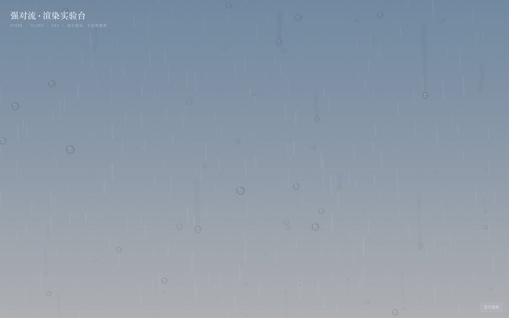<br>
      <sub><b>雨</b> · 雨丝密集斜落，水珠活跃</sub>
    </td>
  </tr>
  <tr>
    <td align="center" width="50%">
      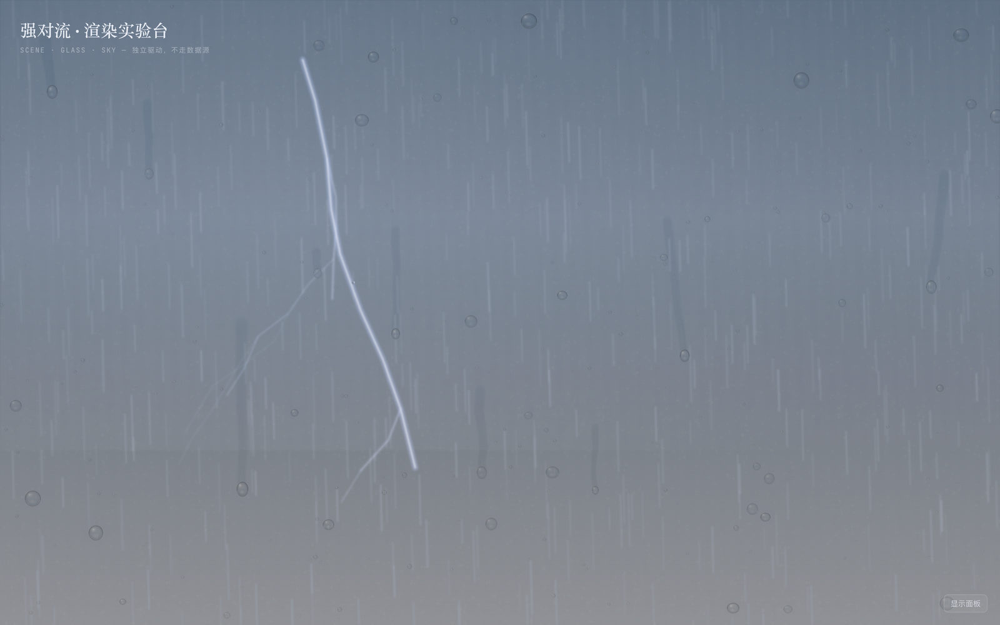<br>
      <sub><b>雷暴</b> · 雨最密、天色最暗，分叉闪电（定格帧）</sub>
    </td>
    <td align="center" width="50%">
      <br>
      <sub><b>雪</b> · 片状慢落，密度与雨相当</sub>
    </td>
  </tr>
</table>

### 强对流实验台

独立页面 `storm.html`：八种天气 × 任意时刻自由组合，右侧面板给出场景、粒子计数与实时 fps，
并支持跟随真实时间、暂停、**定格闪电**（暂停动画后手工渲染一帧，把分叉枝干留在画面里）
与水珠层开关。读数区会实时吐出 `sun`（方位角 / 高度角 / 晕强度）与 `wind`（风速 / 风向 / 偏角）。
截图里风速 45 km/h、风向 270°，读数给出 `lean: -16.3°`。

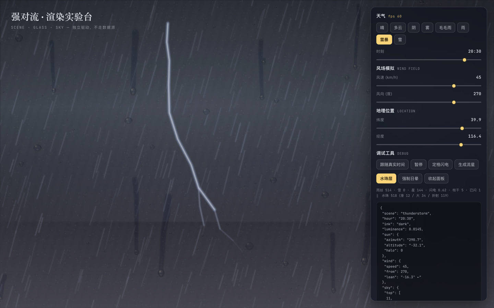

---

## 目录

- [界面一览](#界面一览)
- [技术架构](#技术架构)
  - [三层 Canvas 渲染](#三层-canvas-渲染)
  - [数据源与口径](#数据源与口径)
  - [城市检索：本地优先 + 在线兜底](#城市检索本地优先--在线兜底)
- [核心特性](#核心特性)
  - [22° 日晕：天空里第一次有了太阳](#22-日晕天空里第一次有了太阳)
  - [真实风场：雨丝的方向来自彩云](#真实风场雨丝的方向来自彩云)
  - [晴夜流星](#晴夜流星)
  - [指尖拭雾](#指尖拭雾)
- [快速开始](#快速开始)
- [部署](#部署)
- [项目结构](#项目结构)
- [本地自检](#本地自检)
- [工程笔记：那些踩过的坑](#工程笔记那些踩过的坑)
- [限制](#限制)
- [更新日志](#更新日志)

---

## 技术架构

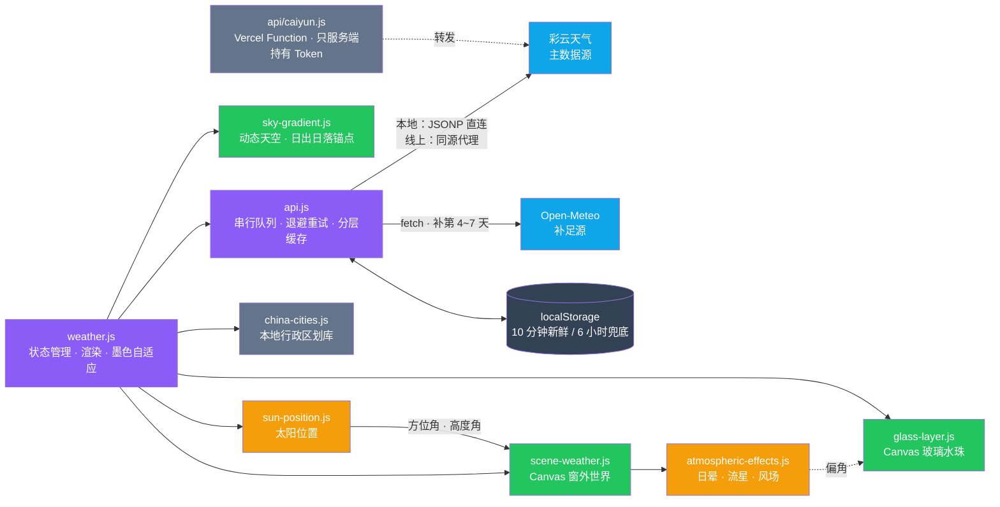

整套前端由**原生 ES Module** 组成，不使用任何框架与打包工具，仓库根目录即部署产物。

### 三层 Canvas 渲染

视觉系统从后到前分三层，各自独立、互不感知：

| 层 | 文件 | 内容 |
|---|---|---|
| 天空渐变 | `sky-gradient.js` | 按小时插值的全屏渐变，按天气调制（压暗 / 去饱和 / 染色）；黎明黄昏的分段锚点绑定当地**真实日出日落** |
| 窗外世界 | `scene-weather.js` | 地平线暖光带、日晕（22° 冰晶色谱 + 镜头鬼影）、星空、雨雪粒子（受真实风场倾斜）、晴夜流星、闪电（逐帧状态机，三层描边分叉） |
| 玻璃水珠 | `glass-layer.js` | 近景水珠：浸润圈、透镜体、高光、投影与滑落水痕，六层结构烘进 24 枚精灵；雨天可用手指擦出水膜 |

天空亮度同时驱动**墨色切换**（`<html data-ink="light\|dark">`）与**水珠采光**（夜间走路灯色温补偿），三层与排版因此始终协调。太阳的真实位置由 `sun-position.js` 逐帧算出，喂给日晕、流星与风场 —— 这是 2.0.0 的骨架。

### 数据源与口径

| 层级 | 数据源 | 职责 |
|---|---|---|
| 主源 | **彩云天气 Caiyun** | 实时天气、24 小时逐时、空气质量（PM2.5 / PM10 / 国标 AQI）、一句话预报、未来 3 天与日出日落 |
| 补足源 | **Open-Meteo** | 补齐彩云试用版只给 3 天的第 4~7 天日预报；紫外线指数**一律以本源为准** |

| 口径 | 取值 | 位置 |
|---|---|---|
| 新鲜缓存 | 10 分钟 | 命中即一次请求都不发 |
| 兜底缓存 | 6 小时 | 被限流时退回旧数据，页脚如实标注 |
| 数据链路总预算 | 6 秒 | 超时立即整体切换 Open-Meteo |
| 天空重算 | 60 秒 | `setInterval(updateSkyGradient, 60000)` |

彩云接口不带 CORS 头：**本地开发**走官方 **JSONP 形态**直连；**线上**则经同源的 Serverless 代理 `api/caiyun.js` 转发 —— 纯静态站藏不住密钥，Token 只存在部署平台的环境变量里（`CAIYUN_TOKEN`），静态文件里一个字节都没有。代理对请求路径设有白名单，不会变成开放代理。

> 这一条是有代价换来的：本项目早期把 Token 写进了 `js/config.local.js` 并一起部署，
> 结果它在公网裸奔了三天。现在的做法是「静态站里没有『藏密钥』这个选项」——
> 任何进入部署目录的文件都能被 `curl` 下载，所以只能让它**根本不进去**。

串行队列 + 指数退避应对 429 限流。页脚始终标注本次实际使用的数据源 —— 两条链路都断时退回本地示例数据，并**如实写明是示例数据**，不静默假装。

### 城市检索：本地优先 + 在线兜底

- **本地行政区划库**（`assets/china-cities.json`，34 省 / 363 市 / 2855 区县，共 3252 条，含中心点坐标，174 KB / gzip 53 KB）首次搜索懒加载、空闲预热；剥离「市 / 区 / 新区」等通名后缀后评分匹配，离线秒回。
- 在线兜底走 Open-Meteo geocoding，**并发查询简繁多个字形变体**再按人口降序 —— GeoNames 的中文别名简繁混杂，「东京」必须查「東京」。

---

## 核心特性

| | 特性 | 说明 |
|---|---|---|
| 🌤 | **实时天气** | 气温、体感、最高/最低温、相对湿度、风向风速（蒲福风级）、降水量、地面气压 |
| 🌫 | **空气质量** | PM2.5 / PM10 浓度与国标分级，带「优 → 严重」六段渐变刻度带，游标按位置在渐变线上取色 |
| 🕐 | **逐时与多日预报** | 24 小时气温走势（图标随昼夜切换）；7 天预报含比例温差动态条 |
| ⭕ | **22° 日晕** | 按太阳真实高度角与方位角出现，冰晶折射色谱（内红外蓝）+ 镜头鬼影，见[下文](#22-日晕天空里第一次有了太阳) |
| 🍃 | **真实风场** | 彩云的风速风向驱动雨丝倾斜（0° → 20°）与玻璃水痕偏转，见[下文](#真实风场雨丝的方向来自彩云) |
| 🌠 | **晴夜流星** | 入夜且晴 / 多云时每 45~90 秒随机一颗，偶遇不扎堆，见[下文](#晴夜流星) |
| 💧 | **指尖拭雾** | 雨天在玻璃上拖动可擦出水膜，停手后缓缓回雾，见[下文](#指尖拭雾) |
| ⚡ | **闪电边缘高光** | 打闪的几十毫秒里玻璃件顶边被同一道冷白光擦亮，全站光影统一 |
| 🎨 | **三层 Canvas** | 天空渐变 → 窗外世界 → 近景玻璃水珠，见[上文](#三层-canvas-渲染) |
| 🌅 | **真实日出日落** | 黎明与黄昏的天空分段锚点绑定定位地点的当日日出日落时刻 |
| 🏙 | **全国城市检索** | 34 省 / 363 市 / 2855 区县离线库，支持简繁字形变体 |
| 🧪 | **强对流实验台** | 独立页面 `storm.html`：8 种天气 × 任意时刻自由组合，定格闪电、粒子计数与 fps 实时显示 |
| 🌙 | **墨色自适应** | 文字、图标按天空亮度自动切换深浅墨色，任何时刻都可读 |
| 📱 | **响应式** | 手机 / 平板 / 桌面自适应布局，同一套代码 |

### 22° 日晕：天空里第一次有了太阳

一个没有太阳位置的天空，画出来的日晕只能是装饰。2.0.0 新增 `js/sun-position.js`
（简化版 SPA 算法，方位角 / 高度角精度 ±0.5°），逐帧把太阳的真实位置交给渲染层，
晕圈于是出现在太阳**该在**的地方。

出现条件按**太阳高度角**判定，不按钟点：

| 太阳高度角 | 晕强度 |
|---|---|
| < 8° | 不出现 |
| 8° → 18° | 线性渐入 |
| ≥ 18° | 全强度 |

> 写死「9~15 点出现日晕」在季节和经度上都会错。北京冬至 9:00 太阳只有 12°；
> 喀什用北京时间、太阳时比北京晚两个多小时，9 点的太阳才刚出地平线。
> 高度角是唯一在任意纬度、任意季节都成立的判据。

天气只在**晴（系数 1.0）/ 多云（0.55）**时给分，其余天气天上看不见太阳。
晕圈是冰晶折射的色谱（内红外蓝，内缘锐、外缘缓），半径取屏幕对角线的 1/5
（夹在 150~420 px），另沿「太阳 → 屏幕中心」连线撒四枚极淡的镜头鬼影。

<div align="center">

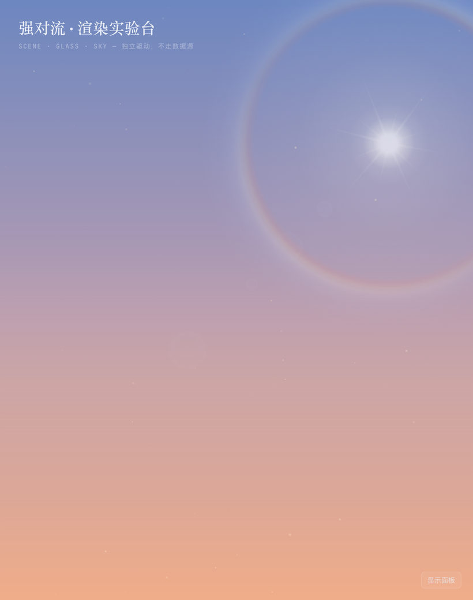

<sub>黄昏 16:24，太阳压到 18° 附近日晕整圈可见；竖构图是因为太阳的屏幕纵坐标恒在画面上部
（`y = h·lerp(0.24, 0.07, …)`），横构图必被顶边裁掉大半圈。</sub>

</div>

太阳 + 星芒 + 晕圈**烘成一张精灵**，逐帧只剩一次 `drawImage`；首帧直接到位（开页不该看着它慢慢亮起来），换天气 / 拖时间约 1.5 秒渐变。

### 真实风场：雨丝的方向来自彩云

彩云的 `wind_speed_10m` / `wind_direction_10m` 第一次真的进了画面：

| 风速 | 雨丝偏角 |
|---|---|
| < 10 km/h | 竖直 |
| 10 → 20 | 0° → 8° |
| 20 → 40 | 8° → 15° |
| 40 → 60 | 15° → 20° |

偏向按风向投影到「面朝赤道」的横向上（北半球东风 → 雨往西 → 屏幕右；南半球左右对调）。

<table>
  <tr>
    <td align="center" width="50%">
      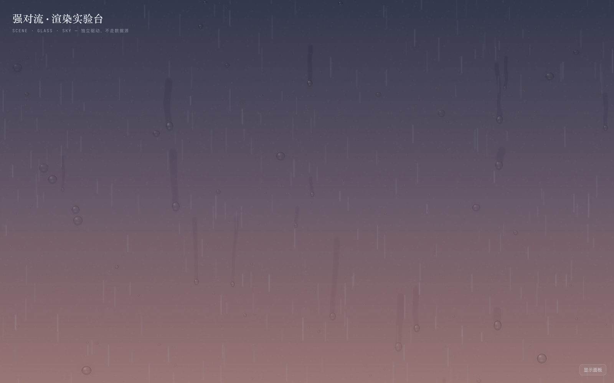<br>
      <sub><b>风速 6 km/h</b> · 偏角 0.0°，雨丝竖直</sub>
    </td>
    <td align="center" width="50%">
      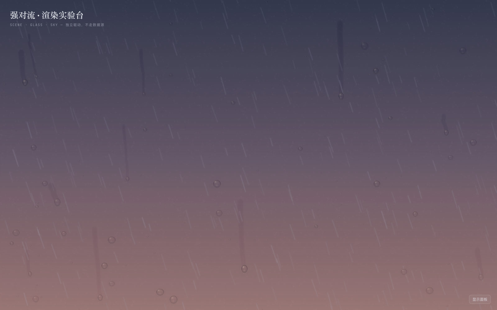<br>
      <sub><b>风速 52 km/h · 东风</b> · 偏角 18.0°，雨丝整体向右倒</sub>
    </td>
  </tr>
</table>

> 两张图是同一个天气场景、同一个风向，只差了风速 —— 也是这套渲染唯一一次
> 「同一画面只改一个变量」的对照。正南 / 正北风的横向分量本为 0，
> 但真实视野不会恰好正对风向，这里保留 **40% 横向下限**，免得「明明有风雨却是直的」。

`lean` 缓动约 1 秒到位（`1 - e^(-2.2·dt)`），不硬切。顺带修掉一个一直错着的地方：**雨丝的「运动方向」和它「画出来的斜度」原本是两回事** —— 线画斜了，粒子本身还垂直下落，看着像逆风。现在两者共用同一个偏角（`vx = vy·tan(偏角)`）。每根雨丝另带一个 `0.82~1.12` 的受风系数：重的雨滴吹得少，整场雨大致一致，而不是一排平行线。

### 晴夜流星

太阳高度角 < −6°（入夜）且晴 / 多云才可能生成，间隔 45~90 秒随机，
寿命 0.4~0.6 秒、速度 900~1400 px/s、尾长 110~180 px，亮度走「快进慢出」
（前 15% 亮起，之后一路消融）。偶遇，不扎堆。

<div align="center">


<sub>按最亮像素簇定位后裁出的 2× 特写 —— 全画幅里它只是一道细线，本图放大了两倍便于看清。</sub>

</div>

### 指尖拭雾

雨天在玻璃上拖动可以擦出水膜（沿轨迹每 ≤ 8 px 采样一次笔刷），停手后缓慢回雾；
滑落的水痕也受风场微弱引导（`drift += windAngle × 0.15`），带一点自然微弧度。

<div align="center">

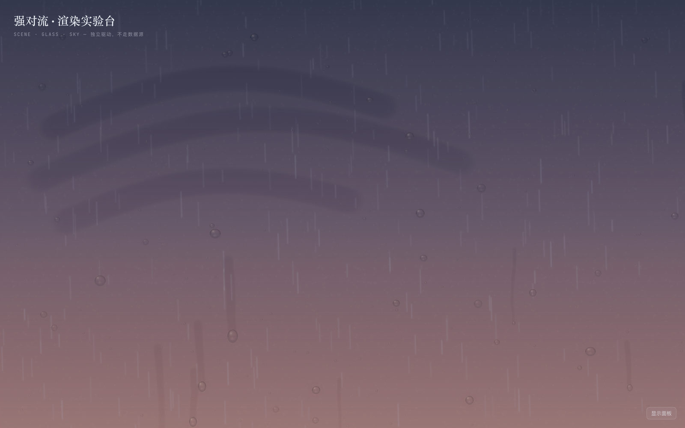

<sub>三道互相搭接的弧形抹痕 —— 手指来回抹几次的真实轨迹。</sub>

</div>

> 监听挂在 `window` 上，不是画布上：玻璃画布是 `pointer-events: none`
> （不能挡住下面的内容），它自己收不到指针事件。

---

## 快速开始

本项目是**零构建的纯静态站点** —— 不需要 `npm install`、不需要打包工具，任何静态服务器都能直接跑。

```bash
# 1) 配置彩云 Token（可选 · 只影响本地开发；线上走环境变量，见「部署」）
cp js/config.example.js js/config.local.js
# 然后编辑 js/config.local.js，把 YOUR_CAIYUN_TOKEN 换成自己的 Token
# 申请入口：https://dashboard.caiyunapp.com/

# 2) 起一个静态服务器
python3 -m http.server 8000
```

浏览器打开 [http://localhost:8000](http://localhost:8000) 即可，根路径会直接渲染天气页（由 `vercel.json` 的 rewrite 负责；本地用 Vercel CLI 起服务时同样生效）。

> **两点注意**
> 1. **必须走 http（或 https）访问，不要用 `file://` 直接打开** —— 项目用 ES Module，`file://` 协议下会被 CORS 拦下。
> 2. `js/config.local.js` 已在 `.gitignore` 与 `.vercelignore` 中，**既不入库也不进部署**。仓库只提供模板 `js/config.example.js`；不配 Token 时页面自动降级到 Open-Meteo 免 Key 数据源，功能不受影响。

另有一个独立实验台页面 [storm.html](https://weather.abobb.com/storm.html)：8 种天气场景 × 任意时刻自由组合，支持定格闪电与水珠层开关，用于单独调校强对流视觉效果。它接受 URL 参数（`?scene=rain&hour=13&wind=52&dir=90&panel=0`），截图与回归都靠这套参数复现同一画面。

---

## 部署

纯静态产物，Vercel / Cloudflare Pages / GitHub Pages 均可直接托管。除彩云数据源外**无需任何后端**；要在线上使用彩云，则需一个转发小函数（见下）：

| 平台 | 配置 |
|---|---|
| **Vercel** | Framework Preset 选 `Other`，Build Command 与 Output Directory 全部留空 |
| **Cloudflare Pages** | 构建命令留空，输出目录填 `/` |
| **GitHub Pages** | Settings → Pages → Source 选分支根目录 |

> **线上彩云数据源怎么配？**
>
> `js/config.local.js` 不在仓库中，平台从 GitHub 拉取构建时不会有这个文件 —— 这**正是想要的结果**。纯静态站里任何文件都是公网可下载的，把 Token 放进去等于公开它。
>
> 线上改用同源代理 `api/caiyun.js`：Vercel 会自动把根目录 `api/` 下的文件编译成 Serverless Function，Token 存在环境变量里，静态文件里一个字节都没有。
>
> ```bash
> vercel env add CAIYUN_TOKEN production   # 粘贴 Token，之后重新部署生效
> ```
>
> 前端只跟同源 `/api/caiyun` 说话，公网拿不到 Token；以后换 Token 也只改环境变量，不碰代码。其他平台（Cloudflare Workers / Pages Functions）把那 80 行转发逻辑搬过去即可 —— 但**别退回**「把 Token 写进静态文件」的老路。
>
> 不配也能跑：页面自动降级到 Open-Meteo 免 Key 数据源，页脚会如实标注本次实际使用的源。

> 🔴 **本项目的部署有一个额外的必做步骤**
>
> `vercel --prod` 完成后，自定义域名**不会**自动指到新部署 —— `weather.abobb.com`
> 会继续挂在上一版产物上，现象是「部署成功但线上还是旧代码」。
> 每次发版都要手动把别名指过去并复核：
>
> ```bash
> vercel --prod --yes
> vercel alias set <本次部署 URL> weather.abobb.com
> vercel alias ls          # 复核 source 指向
> ```
>
> 另注：部署直链 `*.vercel.app` 全部 302 到 `/sso-api`（部署保护），**不能用来校验内容**，只能通过正式域名核对。

---

## 项目结构

```
├── weather.html            # 主页面
├── storm.html              # 强对流实验台（独立页面，不依赖任何数据源）
├── vercel.json             # 根路径 rewrite → weather.html
├── api/
│   └── caiyun.js           # 彩云代理：Token 存部署平台环境变量，静态文件里没有
├── css/
│   ├── weather.css         # 毛玻璃组件体系 · 墨色变量
│   └── sky-gradient.css    # 天空层样式
├── js/
│   ├── math-utils.js       # 共享数学 / 颜色工具（clamp · lerp · mix · waterTint）
│   ├── weather.js          # 状态管理 · 渲染 · 墨色自适应
│   ├── api.js              # 数据源分层 · 彩云双通道 · 缓存
│   ├── sky-gradient.js     # 天空渐变 · 日出日落锚点
│   ├── sun-position.js     # 太阳方位角与高度角（简化版 SPA）
│   ├── atmospheric-effects.js  # 日晕 · 流星 · 风场 · 闪电边缘高光
│   ├── scene-weather.js    # Canvas 窗外世界（雨雪/闪电/雾霾/日晕/流星）
│   ├── glass-layer.js      # Canvas 玻璃水珠（六层精灵化 · 指尖拭雾）
│   ├── weather-codes.js    # 31 条 WMO 编码 → 图标与中文标签
│   ├── china-cities.js     # 本地城市检索匹配
│   ├── zh-variant.js       # 简繁字形变体表
│   ├── storm.js            # 实验台面板逻辑
│   └── config.example.js   # 彩云 Token 模板（config.local.js 不入库）
├── assets/
│   ├── china-cities.json   # 全国区划库 3252 条（含中心点，174 KB / gzip 53 KB）
│   ├── logo-weather.png    # 站名字标（墨色遮罩）
│   └── favicon.*           # 站点图标：svg（优先）+ ico 七档 + 16/32/180 png
└── docs/screenshots/       # README 展示图：3 张主看板 + 八种天气 + 实验台 + 4 张特性图
```

规模：前端 12 个模块 **5269 行**（不含配置模板），CSS + HTML 1578 行。

---

## 本地自检

仓库目前**不带自动化测试套件**（`test/` 目录不在版本库内），日常改动靠三步人工核对：

```bash
# 1) 全量语法自检（12 个模块 + 代理函数）
for f in js/*.js api/*.js; do node --check "$f" || echo "FAIL $f"; done

# 2) 起本地静态服务（必须后台常驻，否则进程被子 shell 回收）
python3 -m http.server 8791 --bind 127.0.0.1 &

# 3) 线上探活：彩云代理是否拿到 Token
curl -s 'https://weather.abobb.com/api/caiyun?health'   # → {"ok":true,"hasToken":true}
```

页面内置三个**调试 / 自动化入口**，回归脚本靠它们把画面钉到确定状态：

| 入口 | 作用 |
|---|---|
| `window.__skyTime(h)` | 跳到某时刻渲染一帧；`null` 回真实时间（主站与实验台同名同义） |
| `window.__sunAnchors(rise, set)` | 注入测试用日出日落锚点，验证天空分段边界 |
| `window.__sceneWeather` / `__glassLayer` | 暴露两层画布引擎，用于断言层序、粒子数、`lean` 偏角 |

实验台还接受 URL 参数 `?scene=&hour=&wind=&dir=&halo&panel=0` —— 本文档里每一张天气截图都是这么复现的。

---

## 工程笔记：那些踩过的坑

- **日晕按高度角，不按钟点** —— 理由见[上文](#22-日晕天空里第一次有了太阳)。这是本项目里「凭直觉写会错」最典型的一处。
- **太阳位置与天空渐变必须共用一个钟** —— 天空按小时数插值，太阳就得按同一个小时数算（`setClock()`）。否则实验台拖到正午，太阳还留在真实时间的位置上，日晕与天色对不上。
- **雨的运动方向 = 它画出来的斜度** —— 两者共用一个偏角（`vx = vy·tan(偏角)`），分开算就会「斜着落但直线掉」，像逆风。
- **闪电高光不动 `border-color`** —— 玻璃件的顶边高光走 `::after` 伪元素 + `inset` 阴影。原有的 `.22s` 边框过渡会把一闪拖成慢慢亮起。
- **`--lightning-rim` 只在值变化时写** —— 每帧 `setProperty` 会让整页每帧重算样式。
- **`html` / `body` 不能有不透明背景** —— 天空层与窗外世界都是负 `z-index`，负层被绘制在**根背景之下**，一旦给 `body` 上色就会被整个盖掉，画面上只剩玻璃水珠（实测就是纯黑底 + 白点）。
- **天空渐变不能加 transition** —— 渐变不可插值，写了也是硬切，反而会让视口边缘的两条采样带滞后去追（`sky-edge-tint`，专为喂 Safari 26 的工具栏 tint 采样器而设，该机制已作为 WebKit Bug 325446 提交）。
- **`.md` 与 `.env*` 必须写进 `.vercelignore`** —— `.gitignore` 对 Vercel **无效**。本站的 README / CHANGELOG 以及 `vercel link` 生成的 `.env.local`（内含 `VERCEL_OIDC_TOKEN`）都靠这一行拦在部署之外，否则会直接出现在站点根目录。发版后例行核对 `/README.md`、`/js/config.local.js`、`/.env.local` 均为 404。
- **截图不能直接 `fullPage`** —— 天空层是 `position: fixed; inset: 0`，只覆盖视口；`fullPage` 会在视口高度以下拼出一片白底（夜间就是白底白字）。正确姿势是先把视口高度收敛到等于整页高度再截。

---

## 限制

- **彩云试用版只给 3 天日预报与较紧的限流** —— 第 4~7 天由 Open-Meteo 补齐，页脚会标注；紫外线指数一律以 Open-Meteo 为准。
- **日晕与流星是简化模型** —— 22° 晕的半径是屏幕比例而非真实视角投影（真实 22° 晕在天上就是个固定视角半径），流星按 45~90 秒的随机间隔生成，不是真实流星雨模型。两者都追求「看着对」，不追求天文级准确。
- **县城与村级地名覆盖不全** —— 区划库到区县级（2855 个），更细的地名靠在线 geocoding 兜底。
- **零构建的代价** —— 没有打包、没有 tree-shaking，模块按需 `import`，首次加载的请求数略多于打包站；换来的是改一行、刷新即见的调试体验与「仓库根目录即产物」的部署模型。
- **唯一的外部静态依赖是 Google Fonts** —— 取不到时回落到系统字体，不影响功能。

---

## 更新日志

见 [CHANGELOG.md](CHANGELOG.md)。当前版本 **v2.1.0**（2026-10-11）。

---

## 版权

**Designed & Coded by AlistairBo · © 2026**

本项目的代码、文案、界面设计与全部截图均由 **AlistairBo** 设计与实现，版权归其所有。

界面图标来自 [Icons8](https://icons8.com)（中文站 [igoutu.cn](https://igoutu.cn)），按其免费许可在此署名；
天气数据由[彩云天气](https://caiyunapp.com)与 [Open-Meteo](https://open-meteo.com) 提供，版权归各自所有。
页面顶部左上角的品牌图标为 `pulsar-line / partly-cloudy-day`（1600px 官方源）经裁边、等比缩放而来，
白色版本由该源的黑色像素反色得到。
